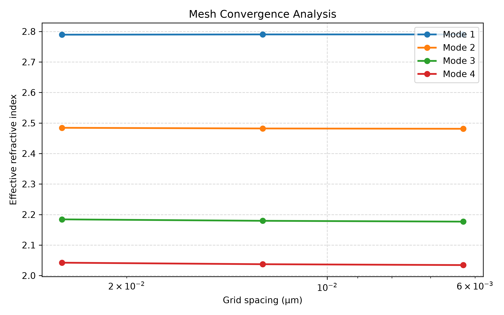
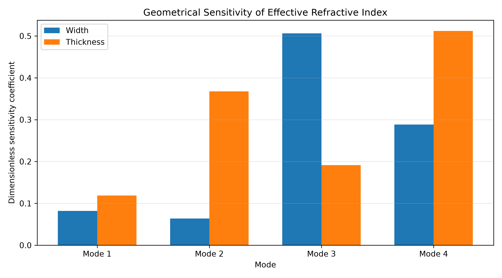
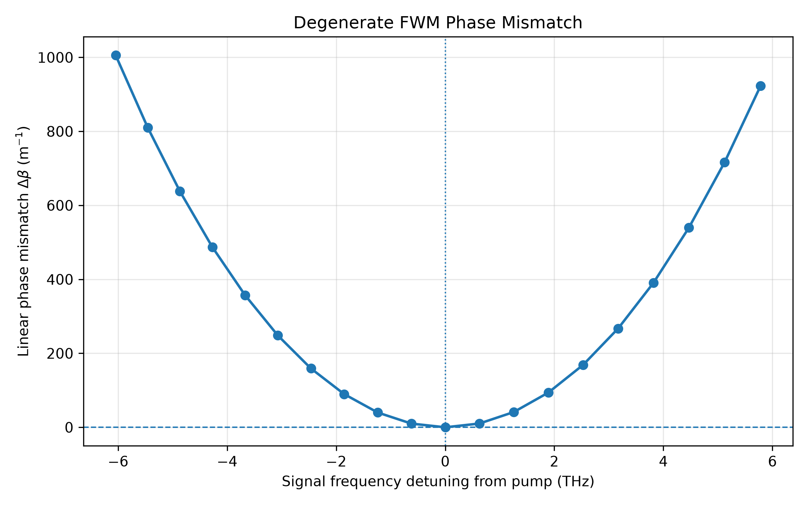
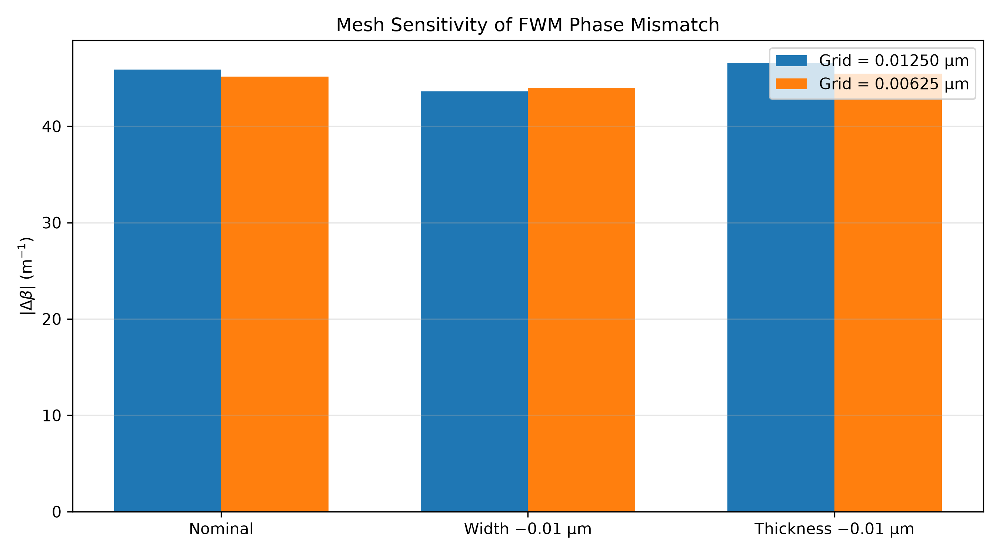
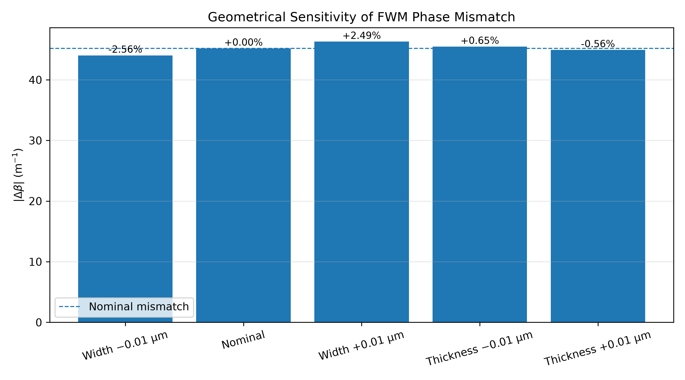

# Numerical Analysis of Dispersion, Linear Phase Mismatch, and Geometric Sensitivity in AlGaAs-on-Insulator Waveguides for Four-Wave Mixing

## Project Overview

This project investigates the numerical modeling of degenerate four-wave mixing (FWM) in AlGaAs-on-insulator (AlGaAsOI) integrated optical waveguides, with an emphasis on modal properties, dispersion engineering, phase mismatch, and sensitivity to geometrical variations.

The primary objective is to establish a reproducible computational framework for studying how waveguide geometry and numerical discretization influence the modal characteristics and linear FWM phase-matching conditions.

The current work represents a preliminary numerical study rather than a validated or optimized device design.

## Research Objectives

- Calculate guided modes and their effective refractive indices.
- Analyze modal field distributions and polarization characteristics.
- Investigate waveguide dispersion and modal continuity across wavelength.
- Evaluate linear FWM phase mismatch using calculated modal propagation constants.
- Examine the sensitivity of modal properties and phase mismatch to geometrical variations.
- Assess the influence of spatial discretization on the numerical results.

## Physical Platform and Initial Model

- **Material platform:** AlGaAs core on a silica substrate.
- **Upper and lateral cladding:** Air.
- **Nonlinear process:** Degenerate four-wave mixing.
- **Waveguide geometry:** Rectangular core.
- **Numerical method:** Finite-difference eigenmode analysis.

### Nominal Parameters

| Parameter | Value |
|---|---:|
| Operating wavelength | 1.55 µm |
| Core width | 0.75 µm |
| Core thickness | 0.35 µm |
| Aluminium fraction | 0.21 |
| Spatial grid spacing | 0.00625 µm |
| Computational window | 4 × 4 µm |
| Calculated modes | 4 |

The AlGaAs refractive index is modeled using wavelength-dependent Adachi-type expressions, while the silica refractive index is calculated using the Sellmeier equation.

The material and geometrical configuration represents a simplified computational model and should not be interpreted as a fully validated fabrication stack.

## Current Implementation

The repository includes the following computational analyses:

1. Waveguide geometry and wavelength-dependent material modeling.
2. Numerical calculation of guided modes and effective refractive indices.
3. Modal field visualization and polarization-component analysis.
4. Mesh and computational-domain convergence checks.
5. Wavelength-dependent effective-index calculations.
6. Group-velocity dispersion calculation using polynomial fitting.
7. Modal identity tracking using normalized electric-field overlap.
8. Geometrical sensitivity analysis of effective refractive indices.
9. Dimensionless geometrical sensitivity coefficients.
10. Linear FWM phase-mismatch calculation.
11. Mesh sensitivity analysis of FWM phase mismatch.
12. Geometrical sensitivity analysis of FWM phase mismatch.

## Selected Numerical Results

### 1. Modal Analysis

Four guided modes were calculated for the nominal waveguide geometry. The fundamental-mode effective index was approximately 2.79025 at 1550 nm using the finest grid spacing.

The calculated electric-field distributions are shown below.


### 2. Waveguide Dispersion

The wavelength-dependent effective-index data were calculated over the 1500–1600 nm range, using a 5 nm wavelength increment.

The group-velocity dispersion was estimated by polynomial fitting of the propagation constant as a function of angular frequency.


The calculated value of the second-order dispersion coefficient at 1550 nm is approximately −723.94 ps²/km using a fourth-degree polynomial fit.

These results assess the numerical behavior of the current model and have not been experimentally validated.

### 3. Mesh Convergence

Three spatial grid spacings were examined: 0.025, 0.0125, and 0.00625 µm.

The relative changes in effective index between the two finest resolutions were approximately:

- Mode 1: 0.0004%
- Mode 2: 0.0420%
- Mode 3: 0.1231%
- Mode 4: 0.1387%

The fundamental mode exhibits strong numerical stability under the tested refinement, while higher-order modes show larger changes.



### 4. Modal Identity Tracking

Mode continuity was examined over the wavelength range of 1500–1600 nm using normalized squared electric-field overlap and an assignment algorithm.

The minimum matched overlap was approximately 0.999963, indicating strong continuity of the calculated modal field profiles across the sampled wavelength range.

### 5. Geometrical Sensitivity

The effective refractive indices were evaluated for independent variations in core width and thickness around the nominal geometry.

Dimensionless sensitivity coefficients were calculated using central finite differences.

| Parameter | Mode 1 | Mode 2 | Mode 3 | Mode 4 |
|---|---:|---:|---:|---:|
| Width | 0.0821 | 0.0637 | 0.5060 | 0.2881 |
| Thickness | 0.1187 | 0.3677 | 0.1915 | 0.5120 |

The results indicate that geometrical sensitivity depends on both the waveguide parameter and the calculated mode.



### 6. FWM Phase-Mismatch Analysis

The linear FWM phase mismatch is evaluated using:

\[
\Delta\beta = 2\beta_p-\beta_s-\beta_i
\]

where the pump, signal, and idler propagation constants are calculated from the fundamental-mode effective indices.

The pump wavelength is fixed at 1550 nm. Signal wavelengths are sampled from the available dispersion data, and the idler frequency is determined through energy conservation, ωᵢ = 2ωₚ − ωₛ. Only signal–idler pairs for which the idler wavelength lies within the sampled wavelength range are considered.

The current analysis examines linear phase mismatch and does not include the nonlinear contribution associated with pump power and the nonlinear coefficient.



### 7. Mesh Sensitivity of FWM Phase Mismatch

The linear FWM phase mismatch was recalculated using two spatial grid spacings for three geometrical configurations.

The table reports the absolute value of the signed linear phase mismatch, \(|\Delta\beta|\). The signed values are retained in the corresponding CSV dataset.

| Geometry | \(|\Delta\beta|\), 0.0125 µm grid (m⁻¹) | \(|\Delta\beta|\), 0.00625 µm grid (m⁻¹) |
|---|---:|---:|
| Nominal | 45.9051 | 45.1689 |
| Reduced width | 43.6062 | 44.0130 |
| Reduced thickness | 46.5919 | 45.4615 |

The relative differences between the two grid resolutions range from approximately 0.9% to 2.4% for the tested configurations.

This is a preliminary discretization-sensitivity assessment, not a complete mesh-convergence demonstration.



### 8. Geometrical Sensitivity of FWM Phase Mismatch

The influence of small changes in core width and thickness was investigated around the nominal geometry.

For the tested variations:

- A 0.01 µm reduction in width decreased the mismatch magnitude by approximately 2.56%.
- A 0.01 µm increase in width increased it by approximately 2.49%.
- Thickness variations produced smaller changes, below 0.7%.

Within this limited parameter range, the calculated phase mismatch is more sensitive to core width than to core thickness.



These results are preliminary and do not establish an optimized phase-matched design.

## Repository Structure

```text
algaas-fwm-robust-design/
├── docs/
│   ├── literature_review.md
│   ├── methodology.md
│   └── physical_model.md
├── figures/
├── simulations/
├── src/
├── dispersion_data.csv
├── fwm_geometry_sensitivity.csv
├── fwm_mesh_sensitivity.csv
├── fwm_phase_matching.csv
├── geometrical_tolerance.csv
├── mesh_convergence.csv
├── sensitivity_coefficients.csv
├── requirements.txt
├── LICENSE
├── .gitignore
└── README.md
```

## Installation and Reproducibility

### Requirements

- Python 3.14.2 (used in the current development environment)
- NumPy
- SciPy
- Matplotlib
- Pandas
- Pillow
- `modesolver` (v3.0.2)

Dependencies are listed in `requirements.txt`. Compatibility with other Python versions has not been independently tested.

### Installation

Clone the repository:

```bash
git clone https://github.com/mahdiyeh-ghasemi/algaas-fwm-robust-design.git
cd algaas-fwm-robust-design
```

Create and activate a virtual environment:

```bash
python -m venv .venv
source .venv/bin/activate
```

On Windows PowerShell, use:

```powershell
.venv\Scripts\Activate.ps1
```

Install the dependencies:

```bash
python -m pip install --upgrade pip
python -m pip install -r requirements.txt
```

### Inspect Existing Results

Previously generated numerical datasets and figures are included in the repository. They can be inspected without rerunning the simulations.

Important datasets include:

- `dispersion_data.csv`
- `fwm_phase_matching.csv`
- `fwm_mesh_sensitivity.csv`
- `fwm_geometry_sensitivity.csv`

Figures are stored in the `figures/` directory.

### Reproduce the FWM Analysis

Run the following commands from the repository root.

**1. Generate dispersion data**

```bash
PYTHONPATH=. python simulations/generate_dispersion_data.py
```

This script calculates the fundamental guided mode at 21 wavelengths between 1.50 and 1.60 µm and generates `dispersion_data.csv`. This step involves repeated eigenmode calculations and may take some time.

**2. Calculate linear phase mismatch**

```bash
PYTHONPATH=. python simulations/fwm_phase_matching.py
```

This script reads `dispersion_data.csv`, calculates signal and idler wavelengths under energy conservation, and generates `fwm_phase_matching.csv`.

**3. Generate the FWM phase-mismatch figure**

```bash
PYTHONPATH=. python simulations/plot_fwm_phase_matching.py
```

The figure is saved as `figures/fwm_phase_matching.png`.

### Additional Analyses

Other scripts in `simulations/` cover eigenmode visualization, dispersion, mesh convergence, geometrical tolerance, modal sensitivity, and FWM sensitivity.

For plotting scripts, the corresponding numerical CSV dataset must be available. If it is not already included, run the relevant analysis script first.

### Reproducibility Notes

- Run scripts from the repository root.
- The `PYTHONPATH=.` prefix makes project modules importable.
- Numerical results may vary slightly with software versions and numerical solver implementations.
- Some simulations are computationally intensive.

## Computational Tools

- Python
- NumPy
- SciPy
- Matplotlib
- Pandas
- Electromagnetic eigenmode solver

## Research Scope and Limitations

This is an independent computational research project. The numerical workflow, model assumptions, simulation outputs, and analysis scripts are documented to support reproducibility and critical evaluation.

The current model has several limitations:

- The material and waveguide configuration is simplified.
- The mesh-sensitivity assessment uses only two resolutions for the FWM analysis.
- Fixed-grid discretization can influence the representation of geometrical boundaries.
- The FWM analysis considers linear phase mismatch and does not include nonlinear phase contributions or conversion efficiency.
- No experimental validation has been performed.

Further mesh refinement, broader parameter sweeps, improved physical modeling, and comparison with experimental or reference data are required before drawing conclusions about practical fabrication tolerance.

## Author

**Mahdiyeh Ghasemi**

Research interests: Experimental Photonics, Nonlinear Integrated Photonics, Quantum Systems, and Computational Physics.
