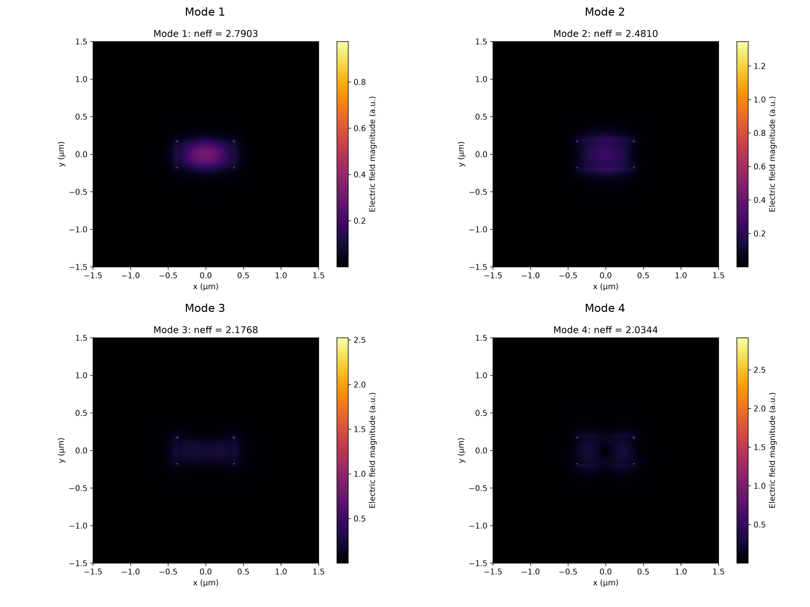
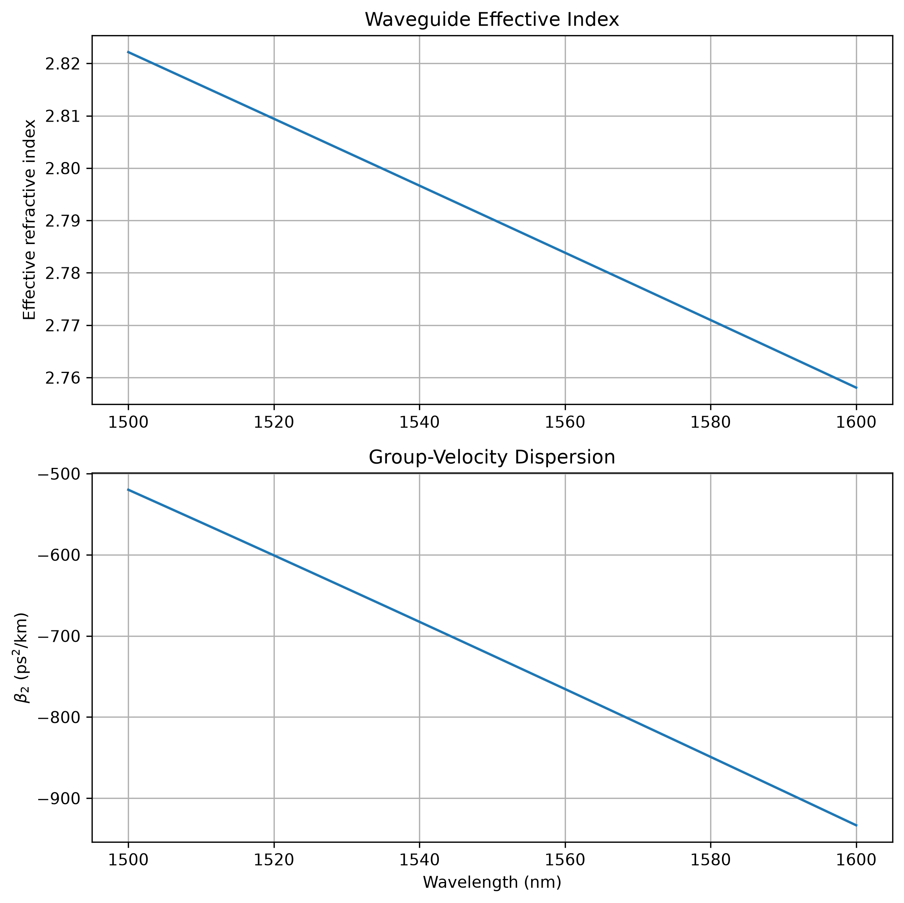

# Fabrication-Tolerant Design of Four-Wave Mixing in AlGaAs-on-Insulator Waveguides

## Project Overview

This project investigates the numerical modeling and fabrication-tolerant design of degenerate four-wave mixing (FWM) in AlGaAs-on-insulator (AlGaAsOI) integrated optical waveguides.

The main objective is to study the relationship between waveguide geometry, modal properties, dispersion engineering, and the potential robustness of nonlinear wavelength conversion against fabrication variations.

## Research Objectives

- Analyze guided modes and their effective refractive indices.
- Investigate the influence of waveguide geometry on modal properties.
- Calculate waveguide dispersion using wavelength-dependent modal data.
- Establish a numerical framework for future FWM phase-matching and fabrication-tolerance studies.

## Physical Platform and Initial Model

- Material platform: AlGaAs core on a silica substrate.
- Upper and lateral cladding: Air.
- Nonlinear process of interest: Degenerate four-wave mixing.
- Initial geometry: Rectangular waveguide.
- Numerical approach: Finite-difference eigenmode analysis.

The current geometry and material configuration represent a simplified numerical model and should not be interpreted as a fully validated fabrication stack.

## Current Implementation

The repository currently includes:

1. Waveguide geometry and wavelength-dependent material modeling.
2. Numerical calculation of guided modes and effective refractive indices.
3. Mesh and computational-domain convergence checks.
4. Modal field and polarization-component analysis.
5. Wavelength-dependent effective-index data generation.
6. Group-velocity dispersion calculation using polynomial fitting.
7. Visualization and comparison of modal and dispersion results.

## Selected Results

### Modal Analysis

Four guided modes have been calculated for the initial waveguide geometry. Their effective indices and field distributions are available in the `figures/` directory.



### Dispersion Analysis

Wavelength-dependent effective-index data have been generated over the 1500–1600 nm range. The corresponding dispersion analysis is available below.



The current dispersion results are numerical outputs of the simplified model and have not yet been experimentally validated.

## Repository Structure

```text
├── docs/
│   ├── literature_review.md
│   ├── methodology.md
│   └── physical_model.md
├── figures/
├── simulations/
├── src/
├── dispersion_data.csv
└── README.md
```

## Computational Tools

- Python
- NumPy
- SciPy
- Matplotlib
- Pandas
- Electromagnetic eigenmode solver

## Ongoing and Planned Work

- Verification of modal identity across the wavelength range.
- Further validation of material and waveguide model assumptions.
- Four-wave mixing phase-matching analysis.
- Nonlinear propagation and conversion-efficiency modeling.
- Fabrication sensitivity and tolerance analysis.
- Numerical optimization of waveguide geometry.

## Research Scope and Limitations

This is an independent computational research project. Model assumptions, numerical methods, and simulation results are documented to support reproducibility and critical evaluation.

The current results are preliminary numerical findings. Experimental validation and comparison with a realistic fabrication platform remain future work.

## Author

**Mahdiyeh Ghasemi**

Research interests: Experimental Photonics, Nonlinear Integrated Photonics, Quantum Systems, and Computational Physics.