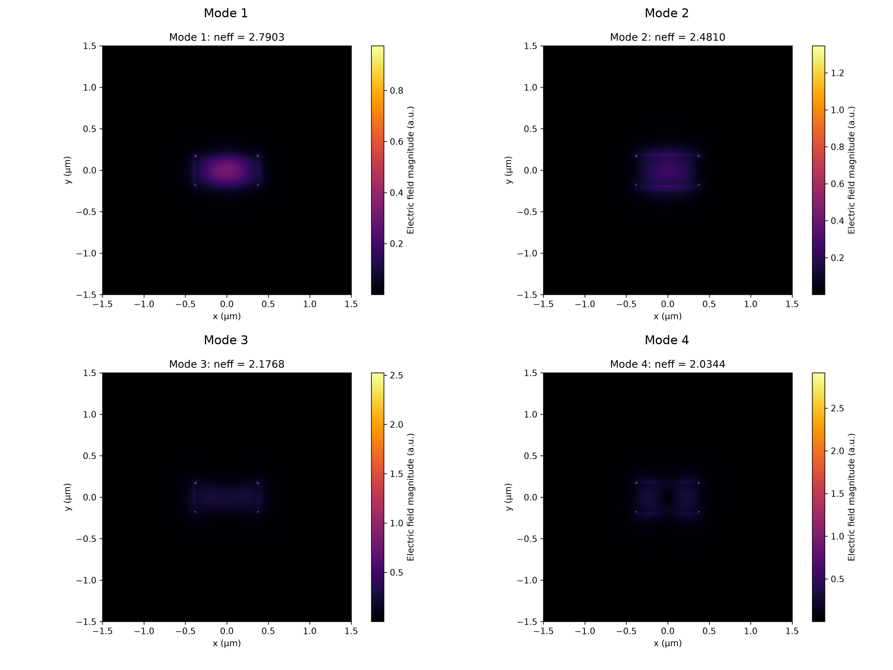
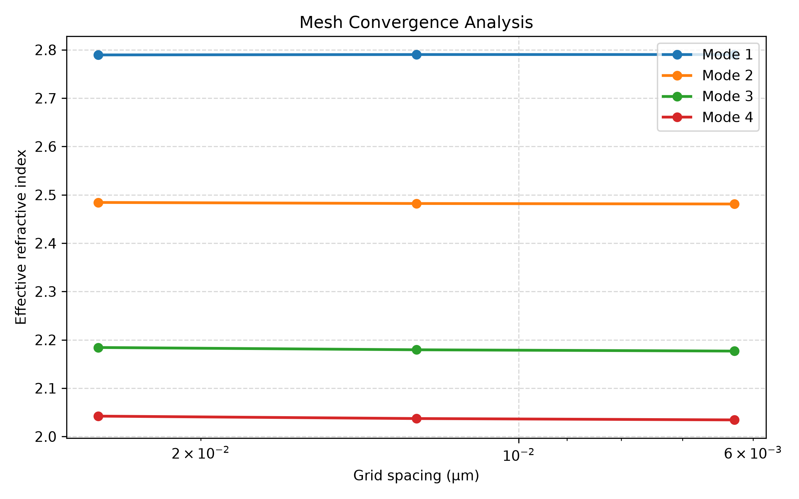
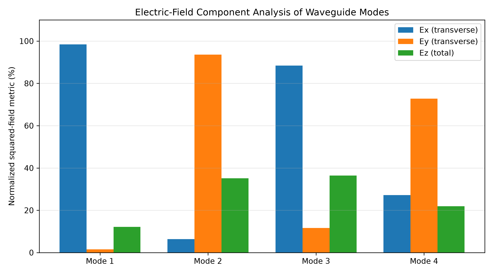
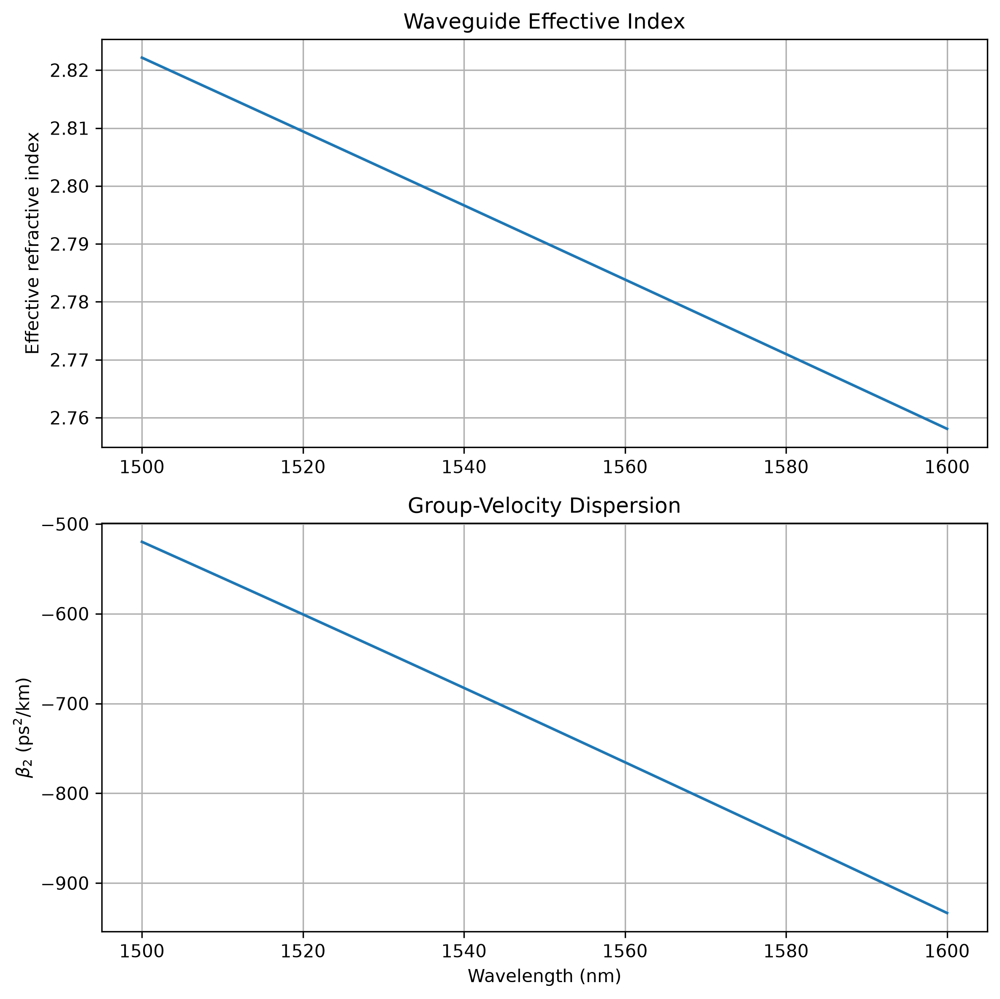
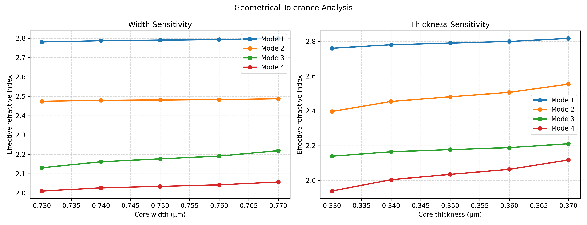

# Methodology: Numerical Modeling and Fabrication-Tolerant Design

## 1. Research Workflow

The project investigates the numerical design of AlGaAs-on-insulator waveguides for four-wave mixing (FWM), with an emphasis on phase matching and fabrication tolerance.

The methodology is organized into five stages:

1. Definition of the waveguide geometry and material parameters.
2. Calculation of modal properties and waveguide dispersion.
3. Evaluation of phase-matching conditions.
4. Analysis of sensitivity to geometrical variations.
5. Numerical optimization of fabrication-tolerant geometries.

The model will be developed progressively, with assumptions and parameter sources documented at each stage.

## 2. Material and Geometrical Parameters

The initial model considers an AlGaAs core on a silica substrate, with air as the upper and lateral cladding.

The main geometrical parameters are:

- Waveguide width: \(W\)
- Core thickness: \(H\)
- Aluminium composition: \(x\)
- Operating wavelength: \(\lambda\)

The initial numerical model uses the following parameters:

| Parameter | Value |
|---|---:|
| Operating wavelength | 1.55 µm |
| Core width | 0.75 µm |
| Core thickness | 0.35 µm |
| Aluminium fraction | 0.21 |
| Grid spacing | 0.00625 µm |
| Simulation window | 4 × 4 µm |
| Number of calculated modes | 4 |

The AlGaAs refractive index is calculated using a wavelength-dependent dispersion model based on Adachi-type expressions. The silica refractive index is calculated using the Sellmeier equation.

The substrate is represented numerically as a silica region extending to the lower boundary of the computational window. Air is used in the upper and lateral cladding regions.

These parameters define an initial computational model and are not intended to represent a fully validated fabrication stack.

## 3. Waveguide Eigenmode Analysis

The guided modes are calculated using a finite-difference eigenmode solver.

The transverse computational domain is discretized using a uniform spatial grid. The relative-permittivity distribution is constructed from the refractive indices of the AlGaAs core, silica substrate, and air cladding.

The eigenmode solver calculates the effective indices and electromagnetic field components of the supported modes.

The propagation constant is obtained from:

\[
\beta = \frac{2\pi}{\lambda}n_{\mathrm{eff}}
\]

The calculations are repeated over the wavelength range of interest to characterize the wavelength dependence of the modal properties.

### 3.1 Modal Field Profiles

The transverse and longitudinal electric-field components are combined to visualize the spatial field distribution of each calculated mode.

For each mode, the total electric-field magnitude is evaluated as:

\[
|E| = \sqrt{|E_x|^2+|E_y|^2+|E_z|^2}
\]

The resulting field profiles are presented in Figure 1. Four guided modes are obtained using the numerical eigenmode solver.

**Figure 1.** Spatial electric-field magnitude distributions of the four calculated waveguide modes. Each panel shows one mode.

## 4. Mesh Convergence Analysis

A mesh convergence analysis is performed to evaluate the sensitivity of the calculated effective indices to the spatial discretization of the computational domain.

Three grid spacings are considered:

- 0.025 µm
- 0.0125 µm
- 0.00625 µm

For each grid resolution, the eigenmode solver is used to calculate the effective indices of the four guided modes at the reference wavelength of 1.55 µm. All other waveguide parameters and material properties are kept unchanged.

The calculated effective indices are summarized below.

| Grid spacing (µm) | Mode 1 | Mode 2 | Mode 3 | Mode 4 |
|---:|---:|---:|---:|---:|
| 0.02500 | 2.789443 | 2.484256 | 2.184165 | 2.042173 |
| 0.01250 | 2.790239 | 2.482065 | 2.179440 | 2.037194 |
| 0.00625 | 2.790250 | 2.481024 | 2.176761 | 2.034373 |

The relative changes in effective index between the two finest grid resolutions are approximately 0.0004%, 0.0420%, 0.1231%, and 0.1387% for modes 1–4, respectively.

The results indicate that the fundamental-mode effective index is highly stable under the tested mesh refinement. The higher-order modes exhibit larger changes, suggesting that their numerical convergence is less complete and requires further investigation.

The finest grid spacing of 0.00625 µm is therefore adopted for the subsequent simulations. This choice provides a stable fundamental-mode result while retaining the higher-order modes for further analysis.

The numerical results are stored in `mesh_convergence.csv` and can be reproduced using `simulations/mesh_convergence.py`.

The corresponding mesh convergence plot is shown below.

## 5. Computational Domain Size Convergence

The influence of the computational window size is evaluated by comparing the calculated effective indices for different domain dimensions.

The 4 × 4 µm computational window is compared with a 3 × 3 µm window while maintaining the same spatial grid spacing.

The calculated effective indices show negligible differences between the two domain sizes for the four modes considered.

The field magnitude near the computational boundaries is also examined to assess possible boundary effects.

## 6. Modal Polarization Analysis

The relative contributions of the electric-field components are evaluated for each calculated mode.

The transverse component indicators are defined as:

\[
R_x = \frac{\sum |E_x|^2}
{\sum |E_x|^2+\sum |E_y|^2}
\]

\[
R_y = \frac{\sum |E_y|^2}
{\sum |E_x|^2+\sum |E_y|^2}
\]

The longitudinal-field indicator is defined as:

\[
R_z = \frac{\sum |E_z|^2}
{\sum |E_x|^2+\sum |E_y|^2+\sum |E_z|^2}
\]

These quantities are normalized squared-field component indicators. They are not physical modal power fractions, which would require evaluation of the Poynting flux.

The calculated results indicate that modes 1 and 3 are predominantly x-oriented in their transverse electric-field components, whereas modes 2 and 4 are predominantly y-oriented.

**Figure 2.** Normalized squared-field component indicators for the four calculated modes.

## 7. Waveguide Dispersion Analysis

Waveguide dispersion is characterized using derivatives of the propagation constant with respect to angular frequency.

The group-velocity dispersion parameter is:

\[
\beta_2 = \frac{\partial^2 \beta}{\partial \omega^2}
\]

The propagation constant is calculated from the wavelength-dependent effective index obtained from the eigenmode solver.

To evaluate the second-order derivative, the angular-frequency data are normalized and fitted using a fourth-degree polynomial. The analytical second derivative of the fitted polynomial is then evaluated over the wavelength range.

The polynomial degree is assessed by comparing degrees two through five. At 1550 nm, the fourth- and fifth-degree fits produce nearly identical values of \(\beta_2\).

The fourth-degree fit is also tested for sensitivity to endpoint removal. Removing up to three data points from each end of the wavelength interval results in negligible changes in the calculated value at 1550 nm.

These tests assess numerical fitting stability but do not independently validate the physical accuracy of the material or waveguide model.

The calculated effective-index and group-velocity-dispersion curves are presented in Figure 3.

**Figure 3.** Effective refractive index and calculated group-velocity dispersion as functions of wavelength.

### 7.1 Modal Identity Tracking

To assess the continuity of the calculated modes across the wavelength range, an electric-field overlap analysis is performed between consecutive wavelength points.

For each pair of adjacent wavelengths, the normalized squared overlap between the electric-field distributions is calculated:

\[
O_{ij} =
\frac{
|\langle E_i(\lambda_k), E_j(\lambda_{k+1}) \rangle|^2
}{
\langle E_i(\lambda_k), E_i(\lambda_k) \rangle
\langle E_j(\lambda_{k+1}), E_j(\lambda_{k+1}) \rangle
}
\]

The overlap calculation combines the three electric-field components \(E_x\), \(E_y\), and \(E_z\). The mode correspondence between successive wavelength points is determined by maximizing the total overlap using the linear assignment algorithm.

The discrete inner product is evaluated as a sum over all transverse grid points and the three electric-field components, using the same spatial grid at both wavelengths.

For the wavelength sweep from 1500 nm to 1600 nm, with a 5 nm increment, the calculated mode correspondence remains unchanged across all consecutive wavelength pairs.

The minimum matched overlap obtained in this analysis is approximately 0.999963.

These results indicate strong continuity of the calculated electric-field profiles across the sampled wavelength range. They support the use of the fundamental-mode effective-index data for the current dispersion analysis.

This overlap analysis is a numerical mode-tracking check. It does not independently establish the physical accuracy of the waveguide model or replace validation against experimental or reference data.

## 8. Geometrical Sensitivity Analysis

The sensitivity of the calculated effective indices to variations in the waveguide core width and thickness is investigated using independent parameter sweeps.

The nominal geometry is defined by:

- Core width: 0.75 µm
- Core thickness: 0.35 µm

Each geometrical parameter is varied independently while the other geometrical parameter, material properties, wavelength, and numerical settings are kept unchanged.

For the width sweep, the core width ranges from 0.73 µm to 0.77 µm. For the thickness sweep, the core thickness ranges from 0.33 µm to 0.37 µm. Five values are evaluated for each parameter.

The calculated effective indices of the four modes are stored in `geometrical_tolerance.csv`. The analysis can be reproduced using `simulations/geometrical_tolerance.py`.

The resulting sensitivity curves are shown below.

The results show that the effective indices increase with both core width and core thickness over the investigated ranges. The magnitude of the response differs between modes and geometrical parameters.

For the fundamental mode, the effective index changes from approximately 2.7807 to 2.7991 over the investigated width range, and from 2.7602 to 2.8171 over the investigated thickness range.

These results represent numerical geometrical sensitivity under the current simplified waveguide model. Since the spatial grid is fixed, changes in the discretized core boundaries may also influence the calculated effective indices. Further mesh-refinement and mode-continuity checks are therefore required before interpreting these results as realistic fabrication tolerances.

## 9. Phase Matching and Fabrication-Tolerant Optimization

The next stage of the project will investigate four-wave-mixing phase-matching conditions using the calculated modal propagation constants.

The phase mismatch will be evaluated for the interacting pump, signal, and idler waves.

Subsequently, the sensitivity of phase matching to variations in waveguide width, core thickness, and material composition will be investigated.

The final objective is to identify geometrical configurations that maintain acceptable phase-matching conditions under realistic fabrication variations.
